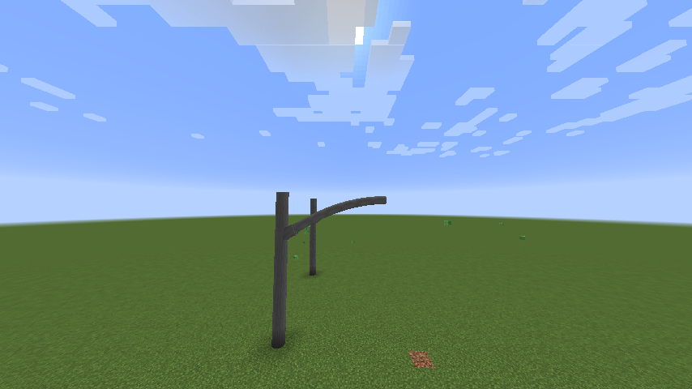

# Mast Arms

The realistically scaled curved upsweeps that take a signal mast arm off a pole and out over the
roadway.

## Why they are several blocks

<figure markdown="span">
  { loading=lazy }
  <figcaption>A 6×2 upsweep. It leaves the pole on a slope and arrives horizontal, so the straight run can continue from it without a kink.</figcaption>
</figure>

A real curved mast arm covers **10–25 feet of run and 4–10 feet of rise**, leaves the pole at
roughly 20–35°, and arrives at the horizontal run with **zero** slope so the joint does not kink.

None of that fits in one Minecraft block model. The original upsweep,
`trafficpoleverticalcurveconnector`, is already as large as a Forge JSON model is legally allowed
to be — and it is not really a curve at all, but 130 stacked slabs making a constant-slope ramp
with a staircased silhouette. It is still there and still works; the curves on this page are the
bigger, smoother alternative.

So each curve is a **connected staircase of real blocks**, one per cell the arm passes through,
each drawing its own slice of one continuous sweep. That costs more blocks, and buys three things
a single giant model could never have:

1. **It does not vanish.** A model belongs to its block's chunk section. A six-block arm hanging
   off one block disappears the instant that block is culled while the arm is still on screen.
2. **Things can mount to it.** Signal heads, signs and luminaires attach to *blocks*. With one
   block, nothing could hang off the curved part — and real intersections hang things there.
3. **Auto-connect works.** The pole mounting system reads neighbouring block positions, and empty
   air is invisible to it.

The geometry still reads as continuous, because each band of the sweep is drawn whole by whichever
cell owns it.

## The sizes

Five curves, named for the road they suit:

| Curve | Run × rise | Suits |
|---|---|---|
| 4×1 | 4 blocks out, 1 up | Local street |
| 5×1 | 5 × 1 | Collector |
| 6×2 | 6 × 2 | Arterial |
| 8×2 | 8 × 2 | Major intersection |
| 10×2 | 10 × 2 | Wide arterial |

Each comes in the full set of pole colours. All of them are in the
[Traffic Accessories](../reference/traffic-accessories.md) reference.

## Building with one

1. Put up a vertical traffic pole to the height you want the arm to leave at.
2. Place the curve blocks along the cell path, starting at the pole.
3. Continue with horizontal pole sections for the straight run out over the road.
4. Hang signal heads and signs off any cell using the normal mounts.

The curve arrives at horizontal with zero slope, so the straight run continues from it without a
visible kink.

## Truss signal arms

In Massachusetts, New Hampshire and New Jersey a signal arm is often a truss: two pipes that leave
the pole one above the other and meet at the tip, with a few struts between them. CSM has them as
single blocks that place the whole arm, pole to tip, in galvanized, silver and black:

| Arm | Lengths | Shape |
|---|---|---|
| Level Top | 6, 8, 10, 12 blocks | The top pipe is level; the bottom one climbs to meet it. Every signal head sits at one height. |
| Sloped | 8, 12 blocks | Both pipes climb away from the pole. |
| Diagonal | 5, 8 blocks | A level-top arm that crosses the corner at 45 degrees. |

Place one against the side of a pole, at the height the top pipe should leave it; the pole must
reach at least one block lower, where the bottom pipe lands. Signal heads, signs and cameras mount
against the top pipe, and a sign placed under the arm hangs from the bottom pipe.

To hang a signal head from the end of the arm, as New Jersey does, place a **Wire Mount** under
the last block of the arm and the signal head under the mount. The arm grows a hanger down to
it.

A hanging **Dynamic Street Sign** placed under a truss arm, or under a curved mast arm, reaches
up to the pipe above it: each of its hangers stops at the pipe, so under the sloping bottom pipe
of a truss they come out different lengths.

A **diagonal** arm always turns to the right of the face you place it on: on a pole's north face it
reaches north-east, on its east face south-east. Pick the face one turn to the left of the corner
you want it to cross.

## New York City arms

The signal arm of New York City is one tapered pipe that leaves the pole low, bends and climbs out
over the street, with two thin guy rods holding its tip up from a crossbar higher on the pole. The signal head
hangs from the very end. CSM has it as single blocks that place the whole arm, in brown,
galvanized and black:

| Arm | Lengths | Pole must reach |
|---|---|---|
| Regular | 4, 6, 8 blocks | 1 block lower (4), 2 blocks lower (6, 8) |
| Diagonal | 4, 6 blocks | 2 blocks lower |

Place one against the side of a pole at the height of the guy rods, which is the height of the
tip. The pipe's clamp lands lower on the pole, so the pole has to be there. A diagonal arm turns
to the right of the face you place it on, as a diagonal truss arm does.

Hang the signal head the way the city does: a **Wire Mount** under the last block of the arm and
the head under the mount. Signs and heads can also mount under or beside the pipe anywhere along
it, and a hanging **Dynamic Street Sign** under it reaches up to the pipe. Nothing mounts to the
guy rods.

## Mounting hardware

Every cell can grow a bracket toward any of its four sides — up, down, and both sides — wherever
there is something mountable against it, the same way a pole does. Along the arm itself there is no
stub, because that is where the arm goes.

A curve deliberately ignores exactly what a pole ignores, and one cell of a curve will not sprout
hardware into the next cell of the same curve.

!!! note "Why the hardware is per cell"

    On a pole, one bracket model serves everywhere, because a pole is a straight tube centred in
    its block. A curve cell's tube is neither centred nor level, and its pose is different in every
    cell — so a shared model would float off the tube in most of them. Each cell carries its own.
